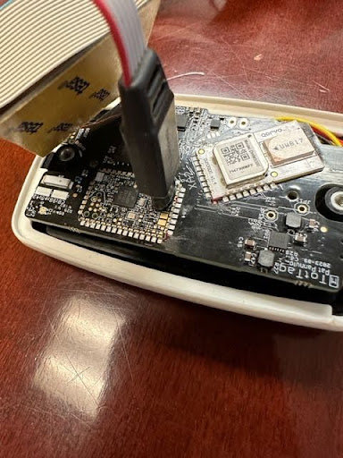

# Getting Started

This page describes the steps necessary to make a brand new TotTag "ready for a study." You need to do it
once per device. If your devices are already set up, skip to [Running a Deployment](running-a-deployment.md).

---

## What you need

### Hardware

A **SEGGER J-Link programmer**, plus an adapter and a cable to interface with the device's programming pads:

- [J-Link EDU Probe](https://shop-us.segger.com/product-category/debug-probes/educational/) — heavily
  discounted for educational and research use. The commercial
  [J-Link](https://www.segger.com/products/flasher-in-circuit-programmer/) works identically.
- [Tag-Connect ARM20-CTX adapter](https://www.tag-connect.com/product/arm20-ctx-20-pin-to-tc2030-idc-adapter-for-cortex) (J-Link 20-pin to the 6-pin cable)
- [Tag-Connect TC2030-IDC-NL cable](https://www.tag-connect.com/product/tc2030-idc-nl) (6-pin, no legs)

The programmer is only needed for setup. Once a device is running, you never need it again unless you
update firmware.

### Software

- [SEGGER J-Link Software Pack](https://www.segger.com/downloads/jlink/)
- The ARM embedded toolchain: On macOS, install with `brew install --cask gcc-arm-embedded`;
  on Debian or Ubuntu, use `sudo apt install gcc-arm-none-eabi`; or install from a
  [direct download](https://developer.arm.com/downloads/-/arm-gnu-toolchain-downloads). Any recent
  version works; the firmware is built and tested with GCC 15.
- The source: Download with `git clone --recursive https://github.com/lab11/socitrack`. Note that
  the `--recursive` flag is required, and the build fails without it

Check that the toolchain is on your path before going further:

```bash
arm-none-eabi-gcc --version
```

---

## Find your board revision

**Do this before flashing.** The revision is silkscreened on the board — a single letter, one of
**M**, **N**, **O**, or **P**.

Each revision has a different pinout. Firmware built for the wrong one compiles perfectly and then
drives the wrong pins, which looks like a dead or erratic device rather than an obvious error. It is
worth checking rather than assuming, especially with a mixed set of devices.

Every command below uses `BOARD_REV=P`. Substitute your own letter. `P` is the default if you omit it.

---

## Step 1 — Connect the programmer

1. Plug the Tag-Connect adapter and cable into the J-Link programmer.
2. Plug the J-Link programmer into your computer over USB.
3. Press the Tag-Connect cable into the pads on the device labeled **J1** (**XA2** on Rev. M).

The no-legs cable is held in place by hand or with a clip — it does not latch. Keep gentle pressure on
it for the entirety of each command below.



---

## Step 2 — Give the device an ID (once per device)

Every device needs a unique identifier, in the form `c0:98:e5:42:XX:XX`. The last two bytes `XX:XX`
are yours to choose — any four hex digits, except that the last byte cannot be `00`: the ranging
protocol uses 0 to mean "no device", so a device ending in `00` never joins a network.

```bash
cd socitrack/software/firmware
make ID=c0:98:e5:42:00:02 UID
```

**Choose carefully and write it down.** The ranging protocol and the log files identify a device by its
**last byte alone**, so two devices with the same last byte cannot be used together: `00:05` and `01:05`
would be impossible to tell apart in a deployment. Deployment tools will refuse to schedule a deployment
that breaks this rule. A piece of tape on the case with the last four digits saves a great deal of
confusion later.

This step is permanent and only needs doing once. Re-flashing firmware does not erase it.

---

## Step 3 — Load the firmware

```bash
make BOARD_REV=P flash
```

Watch the end of the output. You are looking for:

```
Downloading file [bin/SociTrack.bin]...
Comparing flash   [100%] Done.
Erasing flash     [100%] Done.
Programming flash [100%] Done.
Verifying flash   [100%] Done.
```

Seeing only `Comparing flash [100%] Done.` is also success — it means the device already had exactly
this firmware and nothing needed rewriting.

If you have several J-Links plugged in, you can specify the one you want:

```bash
make BOARD_REV=P SEGGER_SERIAL=123456789 flash
```

---

## Step 4 — Confirm it works

Unplug everything, close the case, replace the screws, and set the device on a wireless charger.

**You should hear a short rising chime.** That is the device telling you it has booted, detected the
charger, and is healthy. No chime means something is wrong — start with
[Troubleshooting](troubleshooting.md#a-device-makes-no-sound-on-the-charger).

Repeat for each device.

---

## Updating firmware later

```bash
cd socitrack
git pull --recurse-submodules
cd software/firmware
make clean
make BOARD_REV=P flash
```

`make clean` matters when switching revisions, because object files from a previous build are not
revision-aware.

Updating firmware **does not** erase the device's ID or its stored logs. Download anything you still
need first, though — a firmware change can alter the log format, and the tools assume a log was
written by firmware of the same era.

### Updating the Bluetooth controller

The Bluetooth radio runs its own separate firmware, and it almost never needs updating. If you have
been explicitly instructed to update it:

```bash
make BOARD_REV=P flashb
```

This writes the controller image first, waits 10 seconds for it to apply, then writes the application.

---

## Next

Your devices are ready. [Running a Deployment](running-a-deployment.md) covers scheduling a study and
collecting the data.
