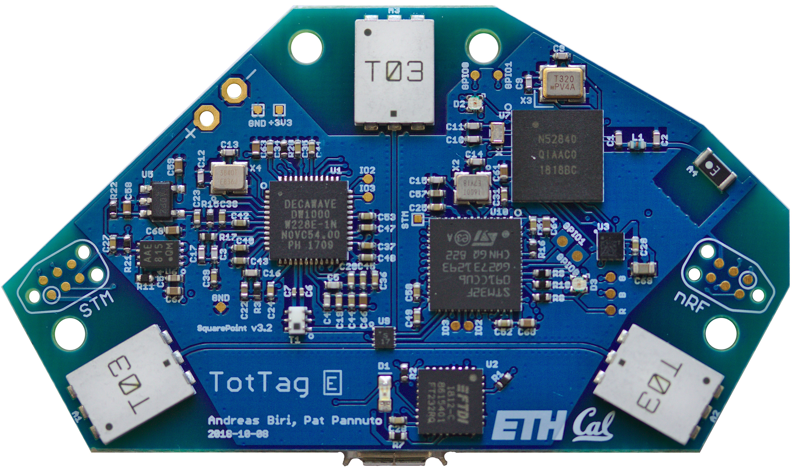

Legacy Hardware
===============

Everything in this folder predates **Rev M** and is obsolete. The current firmware does not support
these boards, and nothing here applies to current devices. It is kept for reference, and for anyone
still holding older hardware.

| Path | Contents |
| --- | --- |
| [`tottag/`](tottag/) | TotTag Rev D–L board designs |
| [`tritag/`](tritag/) | TriTag Rev A–C, including Rev C, the first TotTag-family board |
| [`tripoint/`](tripoint/) | TriPoint UWB ranging module, v1.0–v3.0 |
| [`cad/`](cad/) | Cases and mounts for the boards above, including a 3D-printable Gen 1 TotTag case in [`cad/tottag-case/`](cad/tottag-case/) |
| [`media/`](media/) | Photographs and renders of Gen 1 boards, their programming setup, and the Summon app |

The original localization platform was developed by the Lab11 research group, primarily by
@bpkempke, @bradjc, and @ppannuto. The original TotTag hardware (Rev C and D) was developed by
@abiri as part of a Master's thesis, while a visiting scholar with the Lab11 research group.

PolyPoint (2015) and SurePoint (2016–2017)
------------------------------------------

The PolyPoint system consists of several PCBs centered around TriPoint, the core UWB ranging module.

1. **TriPoint**: A triangular module which contains all of the necessary hardware for utilizing a
   DecaWave DW1000 UWB radio. It has castellated headers so it can be soldered onto a carrier board
   to add indoor localization functionality to any device.

2. **TriTag**: A portable carrier board designed to be used as an indoor localization tag. Contains
   TriPoint on one side and a BLE radio on the other.

PolyPoint later became the SurePoint project. TotTag hardware is largely an evolution of the TriTag
module from these projects.

SociTrack and Gen 1 TotTags (Rev C–H, 2017–2023)
------------------------------------------------

SociTrack used ultra-wideband RF time-of-flight to perform indoor ranging and localization. The
system consists of a single PCB which integrates both an application board and a SquarePoint module.
SquarePoint is available from the [*Lab11 EAGLE* library](https://github.com/lab11/eagle) as a
design block (check version number).

**SquarePoint** is a 30mm x 15mm module holding all of the core ranging hardware and firmware:

- DecaWave DW1000 UWB radio
- STMicroelectronics STM32F091CCU6 MCU
- RF switch

The MCU runs the ranging protocol and controls the DW1000, providing node-to-node ranges to a
carrier board over I2C. The carrier board needs no knowledge of how the ranging is
implemented.

Revisions C–H are the first generation of TotTag hardware, designed primarily for social interaction
tracking. They keep SociTrack's components as cleanly separable features, but integrate dual
microcontrollers onto a single PCB along with SD card logging, an accelerometer, USB connectivity,
wireless charging, debugging ports, LEDs, and battery voltage sensing. Later revisions focused on the
deployability, scaling, and robustness of the caregiver-infant interaction tracking application,
giving a more tightly integrated design geared toward a "wireless only" approach to ease device
management at scale. Gen 1 TotTags carry many design decisions from the original indoor
localization system, and are generally built on "2010-2020" era technologies.

As originally designed (Rev E shown), a Gen 1 board includes:

- The SquarePoint module, with 3 UWB antennas
- Nordic Semiconductor nRF52840 BLE radio
- 3.3V LDO designed to be used with 4.2V LiPo batteries
- Battery charge management controller
- SD card holder
- microUSB connector, including an FTDI FT232R for debugging
- 3-axis accelerometer

Later revisions added to and revised this design, as listed below. A Gen 1 TotTag can act as a
ranging anchor, a mobile tag, or a hybrid of both, and supports both infrastructure-free and
infrastructure-based network processing for centimeter-accurate, multi-day deployments.

### Rev H
[Rev G Issues / Rev H Updates](https://github.com/lab11/socitrack/issues/9)
 - Isolates high-bandwidth accelerometer to dedicated SPI bus
 - Revises wireless charging design for robustness
 - Resolve RTC design issues
 - DFM cleanups

### Rev G
[Rev F Issues / Rev G Updates](https://github.com/lab11/totternary/issues/7)
 - Add detachable battery connector
 - Add power switch
 - Adapt PCB shape for mass-production case

### Rev F
[Rev E Issues / Rev F Updates.](https://github.com/lab11/totternary/issues/4)
 - Add RTC

### Rev E
[Rev D Issues / Rev E Updates.](https://github.com/lab11/totternary/issues/3)
 - Major performance improvements
   - Revise routing, part layout to improve RF performance
   - Capacitor layout around nRF to fix crystal stability issues
 - Add optional switching regulator bypass

### Rev D
[Rev D Issue.](https://github.com/lab11/totternary/issues/2)
 - Add low battery indication
 - Testpoints for buses
 - Fix reset signal for nRF52840
 - Several PCB improvements

### Rev C
[Rev C](tritag/rev_c/)

Revision C was the first of the TotTag family of revisions (though not yet named as such). It
converted the previous hardware modularity into EAGLE design blocks, and was the first single-board
revision. It added several features (storage, sensors) that were not part of the TriTag design.
 - Modularize (design block) ranging design
 - Update BLE to nRF52840
 - Add SD Card
 - Add Accelerometer
 - Update charging design
 - Integrate FTDI

### Gen 1 firmware

The firmware for these boards was removed from the repository when the project moved to the Apollo4
platform. The last version of it is at commit
[`05975ea0`](https://github.com/lab11/socitrack/tree/05975ea06ee88f2a0eae21d97cc68c35f1a21084/software):

| Directory | Contents |
| --- | --- |
| `squarepoint/` | STM32 firmware implementing the ranging protocol on the DW1000. Uses frequency and antenna diversity with both one-way and two-way ToF ranging. Supports a *Standard* mode (the full protocol, over 30 different channels) and a *Calibration* mode, triggered by the calibration scripts, that computes per-board corrections. |
| `tottag/` | The nRF52840 Bluetooth application. Drives SquarePoint as an I2C peripheral, and exposes BLE services to configure the device, set its clock for timestamping, and read ranges in real time. |
| `tottag/mobile_app/` | Web pages for interacting with devices over BLE through the Lab11 [Summon](https://github.com/lab11/summon) app. |

The first Apollo4 TotTags (Rev I–L)
-----------------------------------

Rev I is a fairly complete hardware refresh and board redesign, and the start of the platform current
boards are built on. Initially necessitated by the COVID-era chip shortage, it became an opportunity
to shed many of the legacy IC selections from the project's long design history (some traced back
to the original 2015 PolyPoint board). The most significant changes are moving from a dual-MCU design
to a single MCU, based around the Ambiq Apollo4 family of chips, and upgrading to the newer
generation UWB transceiver, ~~Decawave~~ Qorvo's DW3000 family.

Rev K fixed most of the major flaws from Rev I, but introduced new problems around the DW3000. Rev L
hedged around continued DW3000 issues and replaced the integrated UWB design with three copies of
Qorvo's pre-fab module, a temporary patch to get working systems with the new transceiver more
quickly to enable scale-up. Rev M, the oldest supported revision, has only a cosmetic fix over Rev L;
see [`../tottag/`](../tottag/).

These boards ran the current Apollo4 firmware until support for them was removed. The last firmware
that builds for them (along with the Apollo4 evaluation board, `BOARD_REV=EVB`) is at commit
[`553ff1e3`](https://github.com/lab11/socitrack/tree/553ff1e3101e95510c527e11edd335526b855469/software/firmware).

### Rev L + AP4BP Rev-B
[Prior rev's issues / updates](https://github.com/lab11/socitrack/issues/46)
 - Fixes first-rev issues from the AP4BP module.
 - Rips out our UWB in favor of DWM3000 pre-fab modules for Qorvo as a hedge
   to facilitate more certain-to-work UWB in the short term (but sacrificing
   diversity and robustness [and adding cost]).

### Rev K + AP4BP Rev-A
[Rev I Issues / Rev K Updates](https://github.com/lab11/socitrack/issues/44)
 - (n.b., there is no Rev J to avoid I/J confusion)
 - Move to Apollo4 Blue Plus (Blue has too many silicon bugs)
    - Split this to a castellated module for separation of hw design concerns
 - Move to TCXO for DW3000 (bad idea; will be removed next rev)

### Rev I ***(Major Revision)***
 - Refresh part selection to replace 2015 parts with improved modern versions
 - Major change: Apollo4 Blue as sole MCU
 - Major change: DW3000 replaces DW1000 as UWB transceiver
 - Really, most stuff changed except the wireless charging
